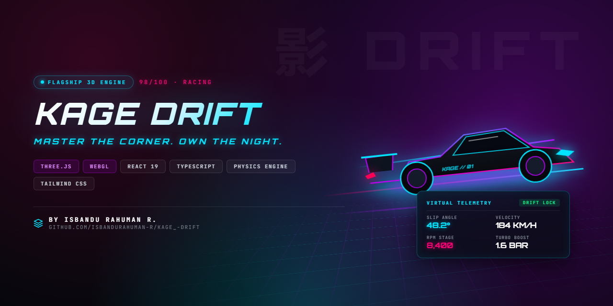

<p align="center">
  
</p>

# 🏎️ KAGE DRIFT // 影ドリフト

[](https://github.com/ISBANDURAHUMAN-R/KAGE_-DRIFT/actions/workflows/deploy.yml)
[](https://isbandurahuman-r.github.io/KAGE_-DRIFT/)
[](./LICENSE)
[](https://www.typescriptlang.org/)
[](https://threejs.org/)
[](https://vitejs.dev/)

### MASTER THE CORNER. OWN THE NIGHT.

**ENTER THE STREETS. FEEL THE SPEED. BECOME THE SHADOW.**

Welcome to **KAGE DRIFT**, a high-octane 3D anime-inspired cyberpunk drifting experience built with **Three.js**, **React 18**, **Tailwind CSS**, and **Vite**. Immerse yourself in the underground JDM racing scene, master challenging corners, unleash your nitro, and create your own legend on the streets.

🏎️ **Play Instantly in Browser**: [https://isbandurahuman-r.github.io/KAGE_-DRIFT/](https://isbandurahuman-r.github.io/KAGE_-DRIFT/)

<pre>
    ██╗  ██╗ █████╗  ██████╗ ███████╗
    ██║ ██╔╝██╔══██╗██╔════╝ ██╔════╝
    █████╔╝ ███████║██║  ███╗█████╗
    ██╔═██╗ ██╔══██║██║   ██║██╔══╝
    ██║  ██╗██║  ██║╚██████╔╝███████╗
    ╚═╝  ╚═╝╚═╝  ╚═╝ ╚═════╝ ╚══════╝
</pre>

---

## 🌃 THE EXPERIENCE

The streets never sleep. The engines never rest.

KAGE DRIFT brings together Japanese street racing culture, futuristic cyberpunk aesthetics, and adrenaline-fueled drifting.

Whether you're chasing the perfect drift, pushing your car to its limits, or exploring the world of underground racing, every moment is about speed, precision, and style.

---

## 🎮 CONTROLS

### Desktop Keyboard
| Key | Function |
| :--- | :--- |
| **`W` / `↑`** | Accelerate Straight Forward |
| **`S` / `↓`** | Carbon Brakes / Reverse Straight Backward |
| **`A` / `←`** | Steer Left (Speed-responsive dynamic heading) |
| **`D` / `→`** | Steer Right (Speed-responsive dynamic heading) |
| **`SPACE`** | Handbrake (Hold while steering at speed to initiate drift) |
| **`SHIFT`** | Ignite N₂O Hyper Boost |
| **`C`** | Cycle Camera (Dynamic Chase ➔ Far ➔ Hood View) |
| **`R`** | Quick Track Centerline Reset |

### Mobile & Touch Gamepad
- **Left Thumb**: Responsive `◀` / `▶` steering buttons.
- **Right Thumb**: Ergonomic `▲ GAS`, `▼ BRK`, `DRIFT`, and `N2O` action pedals.
- **HUD Controls**: Centered tachometer, top-right interactive minimap, audio mute toggle, and music track selector.

---

## ⚡ LOCAL DEVELOPMENT

```bash
# 1. Install dependencies
npm install

# 2. Start local development server
npm run dev

# 3. Compile optimized production build
npm run build

# 4. Preview local production build
npm run preview
```

---

## 📄 LICENSE

This project is open-source and licensed under the [MIT License](./LICENSE) © 2026 ISBANDU RAHUMAN R.
